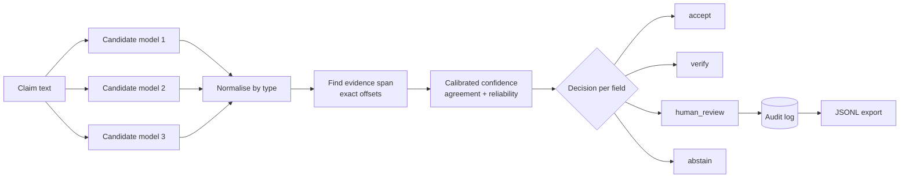

# ArbitrationLab

**Calibrated arbitration of LLM extractions. Every value must exist in the source text, confidence
comes from measured reliability, and the system abstains or asks a human when it isn't sure.**

When several models extract fields from a document, majority voting looks safe but isn't: two
models can be wrong in the same way. ArbitrationLab decides each field from three things:

- **evidence:** an exact span with offsets in the original text,
- **agreement** between candidates,
- **historical reliability:** confidence calibrated on a held-out split.

Each field ends in one of `accept`, `verify`, `human_review` or `abstain`, with the reason logged.
Human reviews are audited and can be exported as labels.

> Fictional domain: car-insurance claim reports for **Seguros Horizonte Azul**. Synthetic data, no
> real personal data.

## Highlights

- **Evidence with offsets.** A value is accepted only if it can be found in the text, and the span
  is returned with exact character offsets.
- **Type-aware normalisation:**
  - ambiguous dates are flagged explicitly,
  - Portuguese and spelled-out amounts are parsed,
  - licence plates, currencies and booleans are normalised.
- **Calibration done properly.** Confidence is fitted on a calibration split (48 cases) and
  evaluated on a separate split (72 cases), with Expected Calibration Error (ECE).
- **Audited human review.** A three-column review panel (candidates, highlighted evidence, verdict)
  records who changed what, when, and the previous value. Reviews export to JSONL.
- **Honest comparison.** Five strategies are compared on accuracy against cost, including the cases
  where arbitration loses.
- **Reusable evaluator.** It plugs into
  [RegressionGuard](https://github.com/agataofrancisco/regressionguard) as an optional evaluator.

## Results (mock models, simulated cost)

From [`experiments/reports/mock-report.md`](experiments/reports/mock-report.md):

| Strategy | Exact match | Macro F1 | Critical errors | Sent to review | Cost/case |
|---|---|---|---|---|---|
| Single cheap model | 75.0% | 0.972 | 2.0% | 0.0% | $0.0020 |
| Single strong model | 83.3% | 0.986 | 0.0% | 0.0% | $0.0200 |
| Majority vote | 75.0% | 0.972 | 2.0% | 0.0% | $0.0240 |
| Evidence arbitration | 75.0% | 0.973 | 1.8% | 0.0% | $0.0240 |
| Arbitration + human review | **87.5%** | 0.982 | 1.8% | 3.6% | $0.0990 |

What the numbers actually say:

1. **Without human review, arbitration doesn't beat the single strong model** on this dataset, and
   it costs more. The README says so rather than claiming a win.
2. Review raises exact match, but the gain assumes a perfect reviewer and depends on the cost per
   field. At $1.00 per field, the average cost per case rises to $0.274.
3. **Evidence proves presence, not correctness.** Nine wrong `claimed_amount` values were accepted
   because a draft line in the text contained a real number.
4. With only 72 evaluation cases there are no confidence intervals, and real models are
   `TODO: measure`.

The full analysis is in [`docs/case-study.md`](docs/case-study.md).

## How it works



## Tech stack

Python 3.12 · FastAPI · Pydantic v2 · SQLite · React + Vite · pytest · Ruff · Docker Compose ·
GitHub Actions

## Run it locally (no Docker, no GPU, no API keys)

```bash
python -m venv .venv && source .venv/bin/activate      # Windows: .venv\Scripts\activate
pip install -e ".[dev]"
python -m arbitrationlab.experiments.run --mode mock --out experiments/reports   # table, chart, JSON
python -m arbitrationlab                                                        # API at http://127.0.0.1:8000
cd frontend && npm ci && npm run dev                                            # review panel at http://localhost:5173
```

Local demo tokens: `demo-client-token` (client role) and `demo-reviewer-token` (reviewer role). Any
other environment must set `ARBITRATIONLAB_CLIENT_TOKEN` and `ARBITRATIONLAB_REVIEWER_TOKEN`.
`--mode real` is deliberately refused because it needs API keys and a manual run.

**Docker** (verified on 2026-11-27: `/health` returns 200 and the container runs as a non-root
user). The compose file refuses to start without the two tokens above. It publishes the API on
`127.0.0.1:8000` only.

```bash
docker compose up --build
```

Endpoints:

- `POST /arbitrations` and `GET /arbitrations/{id}`
- `GET /arbitrations/{id}/candidates`
- `POST /arbitrations/{id}/human-review` (reviewer)
- `GET /reviews/export` (reviewer)
- `GET /metrics`, `GET /schemas/claim` and `GET /health`

## Quality checks

```bash
ruff check . && ruff format --check .
pytest                                                   # 208 tests
python -m arbitrationlab.dataset.generator --out datasets/claims   # deterministic dataset
```

## Known limitations

- **Mock models:** candidates are deterministic mocks with injected errors, and human review is
  simulated from the labels, which is optimistic.
- **Shared reviewer identity:** the reviewer identity is the token's principal, not a per-person
  account.
- **Smoke-only integration:** the RegressionGuard adapter has only been run on an 8-case smoke
  suite.

## Documentation

- [`docs/architecture.md`](docs/architecture.md), [`docs/decisions.md`](docs/decisions.md),
  [`docs/case-study.md`](docs/case-study.md)
- [`docs/learn/`](docs/learn/) (Portuguese): why voting isn't truth, normalisation, evidence and
  offsets, ECE calibration, abstention thresholds, cost against quality, and the RegressionGuard
  evaluator, plus interview questions.
