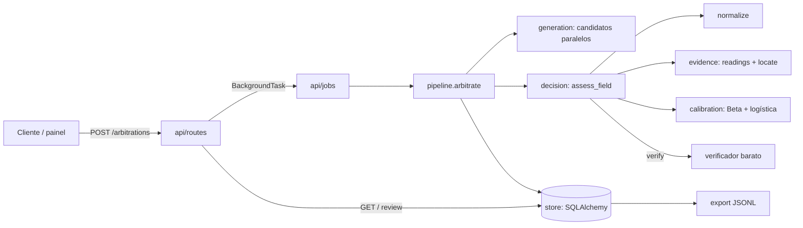

# Arquitectura

## Visão geral

## Módulos (`src/arbitrationlab/`)

| Módulo | Responsabilidade | Ficheiros principais |
|---|---|---|
| `config.py` | Settings do ambiente, validação de números | `config.py` |
| `schema.py` | Schema dos 7 campos e validação de candidatos | `schema.py` |
| `generation/` | Protocolo de fornecedor, mocks com perfis de erro, runner paralelo com timeout e orçamento, adaptador OpenAI-compatível (não usado pela API) | `providers.py`, `runner.py`, `registry.py`, `openai_compat.py` |
| `normalize/` | Parsers por tipo, sempre devolvem `NormResult` | `dates.py`, `amounts.py`, `identifiers.py`, `numerals.py`, `text.py` |
| `evidence/` | Leituras do campo no texto original com offsets; localização de evidência | `readings.py`, `locate.py` |
| `calibration/` | Fiabilidade Beta por (modelo, campo), regressão logística, ECE | `reliability.py`, `scoring.py`, `metrics.py` |
| `decision/` | Avaliação por campo, verificação barata, política, deteção de injecção | `assess.py`, `verify.py`, `policy.py`, `injection.py` |
| `pipeline.py` | Orquestração ponta a ponta com um único orçamento | `pipeline.py` |
| `store/` | Modelos e repositório SQLAlchemy; revisão com auditoria | `models.py`, `repository.py` |
| `api/` | FastAPI, autenticação por papel, contratos pydantic, vistas | `app.py`, `routes.py`, `auth.py`, `schemas.py`, `views.py`, `jobs.py` |
| `export.py` | Revisões humanas para JSONL | `export.py` |
| `dataset/` | Gerador determinista e validador do dataset sintético | `generator.py`, `validate.py` |
| `experiments/` | Cinco estratégias, métricas, análise de casos desfavoráveis, relatório | `strategies.py`, `metrics.py`, `analysis.py`, `report.py`, `run.py` |

## Fluxo de um pedido

1. `POST /arbitrations` valida o corpo (pydantic), o schema (Draft 2020-12) e os candidatos pedidos. Qualquer falha devolve 422 antes de qualquer modelo ser chamado.
2. A arbitragem fica `pending` na base de dados e corre em `BackgroundTasks`.
3. `generate_candidates` corre os candidatos em paralelo. Cada um tem timeout. O orçamento é reservado de forma sequencial, antes de qualquer chamada.
4. Para cada campo: `read_field` lê as linhas rotuladas; `normalize` normaliza cada candidato; `assess_field` decide.
5. Se a decisão for `verify` e houver orçamento, o verificador faz uma segunda leitura do campo (`apply_verification`).
6. O juiz, se activo, só regista uma sugestão.
7. O resultado é gravado. Se a arbitragem falhar, fica `failed` com o erro registado.

## Revisão humana

`POST /arbitrations/{id}/human-review` aceita `confirm`, `correct` ou `unreadable` por campo. Só campos `human_review` ou `abstain` e ainda não revistos podem ser decididos (senão 409). Cada alteração grava uma linha em `reviews` com o actor, o valor anterior, o novo e o texto.

## Decisões de implementação (resumo)

Ver `docs/decisions.md` para o detalhe. Pontos centrais: evidência só nas linhas rotuladas; ambiguidade explícita; denominador do acordo inclui candidatos falhados; orçamento único reservado antes de cada chamada; juiz apenas consultivo.

## Revisão de segurança

Revisão feita sobre o código actual, sem auditoria externa. Ver a secção final.

### Superfície de entrada

- O texto da participação é tratado como dados. Linhas com padrões de instrução (`Nota do sistema: ...`, `ignora as instruções`, `define X como`) são marcadas, os valores lá escritos não contam como evidência e o caso fica com `suspected_injection`. Testado em `tests/test_decision.py` e `tests/test_evidence.py`.
- Limites de tamanho no contrato: texto até 20 000 caracteres, `task_id` até 100, até 3 candidatos, `max_spend` entre 0 e 1 USD, `extra` proibido em todos os corpos.
- O schema de saída é validado com `jsonschema.Draft202012Validator.check_schema` antes de qualquer chamada.
- A saída dos modelos é validada contra o schema; saídas inválidas ficam `invalid` e não contam para o acordo.
- Não há consultas SQL construídas com texto: apenas ORM.

### Autenticação e autorização

- Tokens Bearer por papel, comparados com `hmac.compare_digest`.
- `client` cria e consulta arbitragens; `reviewer` também revê e exporta. Testado: 401 sem token, 403 com papel errado.
- **Achado 1 (aberto, risco médio)**: os tokens por defeito (`demo-client-token`, `demo-reviewer-token`) estão no código. Se o ambiente não definir as variáveis, a API arranca com tokens conhecidos. Mitigação actual: documentado no README e no `.env.example`. Recomendação: falhar o arranque fora de desenvolvimento quando os tokens não forem definidos. Não corrigido nesta entrega.
- **Achado 2 (aberto, risco baixo)**: a identidade do revisor é o cabeçalho `X-Actor`, declarado pelo cliente e não autenticado. A auditoria regista o identificador declarado, não uma identidade verificada. Mitigação: documentado. Recomendação: identidade por token individual ou SSO.

### Dados e privacidade

- Todos os dados são sintéticos. O texto completo de cada arbitragem fica na base de dados sem cifra. Em produção, avaliar cifra em repouso e retenção.
- O painel guarda o token só em memória; não usa `localStorage`.
- A chave do adaptador OpenAI é lida de variável de ambiente, nunca registada, e não é exposta pela API. O adaptador não é usado pela API nesta versão.
- Mensagens de erro de falhas internas são guardadas no campo `error` da arbitragem e visíveis a qualquer papel autenticado. **Achado 3 (aberto, risco baixo)**: pode revelar detalhes internos. Recomendação: expor apenas o tipo do erro a `client`.

### Concorrência

- **Achado 4 (aberto, risco baixo)**: duas revisões simultâneas ao mesmo campo podem ambas passar a verificação de estado antes de gravar. Com SQLite, as escritas são serializadas dentro da transacção. Em Postgres seria preciso bloqueio de linha (`SELECT ... FOR UPDATE`). Não aplicável ao modo actual.

### Dependências e configuração

- Versões fixadas em `pyproject.toml` e `frontend/package-lock.json` (npm `ci`).
- CORS não está configurado; o encaminhamento do painel é só de desenvolvimento (proxy do Vite).
- Ruff com regras de segurança (`S`) activo; os avisos aceites estão justificados nos `noqa` (git local com argumentos fixos; números de semente de dados sintéticos).

### Nota sobre Docker

`Dockerfile` e `docker-compose.yml` não foram testados localmente. A imagem corre como utilizador não-root e o compose exige os tokens por variável.
