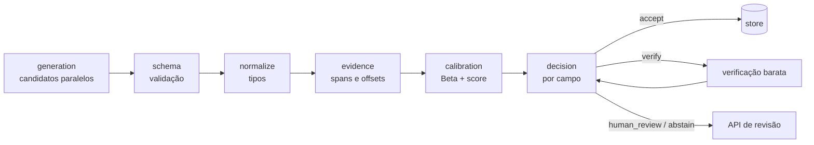

# 00 — Visão geral do ArbitrationLab

## O problema

Um LLM que extrai dados de uma participação de sinistro (data do incidente, matrícula, montante reclamado) erra de forma silenciosa. Um erro num campo custa dinheiro. Pedir a dois ou três modelos e votar por maioria parece uma solução, mas dois modelos podem cometer **o mesmo erro**, e o voto não sabe quando deve ficar calado.

O ArbitrationLab resolve isto com três ideias:

1. **Evidência**: cada valor aceite tem de existir no texto original, com offsets de início e fim.
2. **Calibração**: a confiança vem de acordo, evidência e fiabilidade histórica medida, não de um voto.
3. **Abstenção**: quando a confiança não chega, o sistema envia o campo para revisão humana ou abstém-se.

## O que entra e o que sai

- **Entra**: o texto de uma participação, um JSON Schema de saída, uma política (candidatos, limiares, `max_spend`).
- **Sai**: um veredicto por campo (`accept`, `verify`, `human_review` ou `abstain`), com valor, confiança, motivo e evidência.

## Pipeline



Os módulos correspondem a:

| Passo | Módulo em `src/arbitrationlab/` |
|---|---|
| Geração paralela com timeout e orçamento | `generation/` |
| Validação do schema de saída | `schema.py` |
| Normalização por tipo | `normalize/` |
| Localização de evidência | `evidence/` |
| Fiabilidade, score e ECE | `calibration/` |
| Decisão por campo e injecção | `decision/` |
| Orquestração ponta a ponta | `pipeline.py` |
| Persistência e auditoria | `store/` |
| HTTP e papéis | `api/` |

## Estado actual

Nesta etapa existem as fundações: configuração (`config.py`), autenticação demo por papel (`api/auth.py`), a fábrica da aplicação e `GET /health`. O pipeline completo é construído nas tarefas seguintes do `tasks.md`.

Exemplo real de execução das fundações (saída de um teste de fumo no `TestClient`, comando `python -c` com `create_app`):

```
GET /health -> 200 {'status': 'ok', 'version': '0.1.0'}
GET /rota-inexistente -> 404 {'detail': 'Not Found'}
```

## Porquê esta arquitectura

Cada passo é uma função pura ou um adaptador isolado. Isto permite testar a decisão sem chamar nenhum modelo. Os modelos ficam atrás de um `Protocol`, por isso o mock de CI e um adaptador real são intercambiáveis.

## Alternativas

- **Um único modelo forte com prompt melhor**: simples, mas não dá medida de confiança nem prova de origem.
- **Voto maioritário**: barato de implementar, mas não detecta erros correlacionados.
- **Um juiz LLM como autoridade**: transfere o problema para outro modelo sem evidência verificável.

## Como falha

- A procura de evidência falha com paráfrases ("no início do mês passado"). O campo fica sem evidência e vai para revisão. A taxa é medida na experiência.
- Com poucos dados rotulados, a calibração é instável. Por isso o split de calibração é separado do de avaliação.

Ver os testes em `tests/` para os casos de falha de cada passo.

## Perguntas de entrevista

1. **Porque não usar só votação?** Porque votação não verifica o texto e não distingue erros correlacionados. A evidência é um sinal independente dos modelos.
2. **O que significa abster-se?** Recusar decidir automaticamente e encaminhar o campo para um humano, com o motivo registado.
3. **Onde mora a autoridade final?** No veredicto por campo, que é uma regra auditável. O juiz LLM, quando activo, é apenas consultivo.
