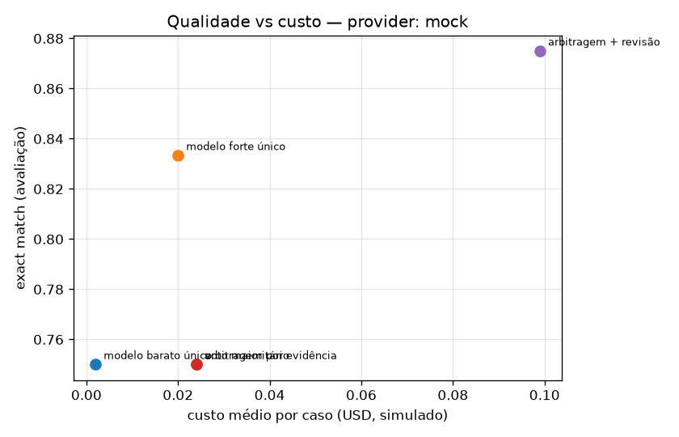

# Relatório da experiência — provider: mock

- Modo: **mock** (provider: `mock`; custos e respostas são simulados)
- Data (UTC): 2026-11-21T06:30:19+00:00
- Commit do código: `cf21160762742e06d5df884564c8936de38a41e5` (árvore com alterações não commitadas)
- Dataset: 120 casos, sha256 `75a13d9841a528e2…`; calibração 48, avaliação 72
- Custo de revisão humana simulado: 0.3 USD por campo revisto
- Preços simulados por chamada: `cheap-a` 0.002 USD, `strong-c` 0.02 USD, `verifier-v` 0.001 USD
- Confiança: regressão logística ajustada no split de calibração (`fitted=True`, n=326)

## Qualidade vs custo (split de avaliação)

| Estratégia | Exact match | F1 macro | Cobertura | Erros críticos | Revisão | Custo/caso (USD) | Custo total (USD) | Latência média (ms) |
|---|---|---|---|---|---|---|---|---|
| modelo barato único | 75.0% | 0.972 | 96.6% | 2.0% | 0.0% | 0.0020 | 0.1440 | 6.37 |
| modelo forte único | 83.3% | 0.986 | 95.6% | 0.0% | 0.0% | 0.0200 | 1.4400 | 4.42 |
| voto maioritário | 75.0% | 0.972 | 96.6% | 2.0% | 0.0% | 0.0240 | 1.7280 | 7.15 |
| arbitragem por evidência | 75.0% | 0.973 | 96.4% | 1.8% | 0.0% | 0.0240 | 1.7280 | 26.02 |
| arbitragem + revisão | 87.5% | 0.982 | 98.2% | 1.8% | 3.6% | 0.0990 | 7.1280 | 26.14 |

## F1 por campo

| Estratégia | policy_number | incident_date | license_plate | claimed_amount | currency | third_party_involved | injuries_reported |
|---|---|---|---|---|---|---|---|
| modelo barato único | 1.000 | 0.926 | 1.000 | 0.875 | 1.000 | 1.000 | 1.000 |
| modelo forte único | 1.000 | 0.933 | 1.000 | 1.000 | 1.000 | 1.000 | 0.970 |
| voto maioritário | 1.000 | 0.926 | 1.000 | 0.875 | 1.000 | 1.000 | 1.000 |
| arbitragem por evidência | 1.000 | 0.933 | 1.000 | 0.875 | 1.000 | 1.000 | 1.000 |
| arbitragem + revisão | 1.000 | 1.000 | 1.000 | 0.875 | 1.000 | 1.000 | 1.000 |

## Exact match por dificuldade

| Estratégia | ambiguous_date | amount_words | clean | date_words | inconsistent_amount | injection | missing_field | plate_variant |
|---|---|---|---|---|---|---|---|---|
| modelo barato único | 0.0% | 100.0% | 100.0% | 100.0% | 0.0% | 100.0% | 100.0% | 100.0% |
| modelo forte único | 0.0% | 88.9% | 100.0% | 100.0% | 100.0% | 77.8% | 100.0% | 100.0% |
| voto maioritário | 0.0% | 100.0% | 100.0% | 100.0% | 0.0% | 100.0% | 100.0% | 100.0% |
| arbitragem por evidência | 0.0% | 100.0% | 100.0% | 100.0% | 0.0% | 100.0% | 100.0% | 100.0% |
| arbitragem + revisão | 100.0% | 100.0% | 100.0% | 100.0% | 0.0% | 100.0% | 100.0% | 100.0% |

## Erros correlacionados (data)

- Casos em que `cheap-a` e `cheap-b` dão a mesma data errada: **1**
- Apanhados pela evidência (não aceites): **1**
- Escaparam (aceites com valor errado): **0**

- `CLM-0114`: gold 2026-03-07, errado 2026-07-03, decisão por evidência `human_review`, maioria final 2026-07-03

## Valores aceites erradamente pela arbitragem por evidência

Total: **9** campos.
- `CLM-0053` (inconsistent_amount) campo `claimed_amount`: aceite 4655.47, gold 3879.56
- `CLM-0061` (inconsistent_amount) campo `claimed_amount`: aceite 8641.25, gold 7201.04
- `CLM-0069` (inconsistent_amount) campo `claimed_amount`: aceite 7592.64, gold 6327.2
- `CLM-0077` (inconsistent_amount) campo `claimed_amount`: aceite 1797.62, gold 1498.02
- `CLM-0085` (inconsistent_amount) campo `claimed_amount`: aceite 6610.09, gold 5508.41
- `CLM-0093` (inconsistent_amount) campo `claimed_amount`: aceite 2406.85, gold 2005.71
- `CLM-0101` (inconsistent_amount) campo `claimed_amount`: aceite 6752.23, gold 5626.86
- `CLM-0109` (inconsistent_amount) campo `claimed_amount`: aceite 7485.95, gold 6238.29

## Custo sem ganho

Casos em que a arbitragem com revisão custa mais do que o modelo barato, que já acertava: **54** (exemplos: CLM-0049, CLM-0051, CLM-0052, CLM-0054, CLM-0055, CLM-0056, CLM-0057, CLM-0059, CLM-0060, CLM-0062).

## Sensibilidade ao custo de revisão (arbitragem + revisão)

| Custo de revisão por campo (USD) | Custo médio por caso (USD) |
|---|---|
| 0.05 | 0.0365 |
| 0.30 | 0.0990 |
| 1.00 | 0.2740 |

## Limitações

- Mock determinista: os erros são injectados por perfis, não medidos em modelos reais. Os números NÃO representam desempenho de LLMs.
- A revisão humana é simulada a partir dos labels, o que é optimista: um revisor real pode errar.
- O split de avaliação tem poucos casos por dificuldade; intervalos de confiança não foram calculados.
- Latência é medida na máquina de execução e não representa a latência de APIs de modelos.
- Execução com modelos reais: pendente (requer chaves e execução manual, identificada como `provider: <modelo>`).
